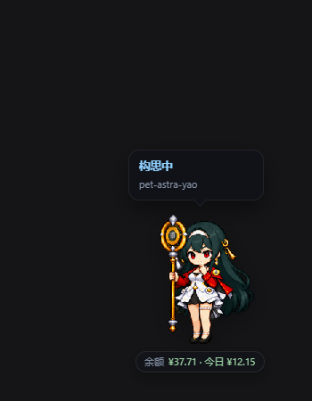
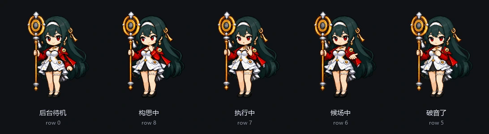
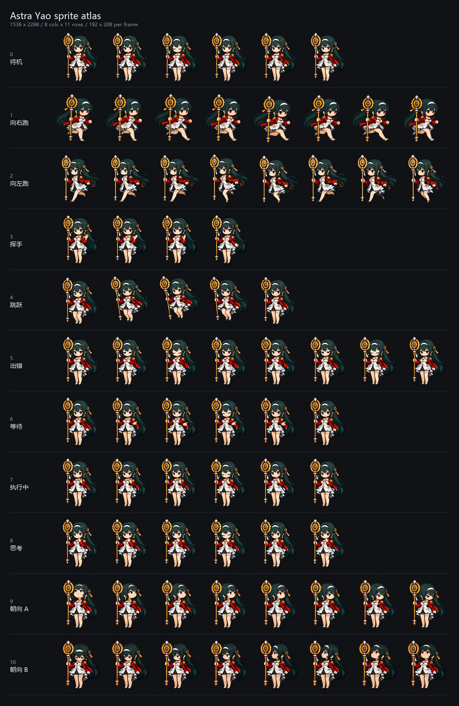

# Astra Yao · Codex 桌宠 ⇄ DSH 插件


同一个仓库，两份可直接用的产物：

- **DeepSeek Harness（DSH）插件** —— 装进 profile 后，Astra Yao 悬浮在 Web 界面右下角，
  跟着会话状态换动作，头顶有状态气泡、脚下有余额条。
- **Codex 桌宠素材包** —— `pet.json` + `spritesheet.webp`，复制到 `%USERPROFILE%\.codex\pets\astra-yao` 即可给 Codex 用。

两边共用同一张 1536×2288 的 Codex v2 图集（8 列 × 11 行，单帧 192×208），没有第二份拷贝。

角色：深墨绿长发、红黑外套、白裙、金色环形话筒立杖的舞台歌手像素小人。
它在 DSH 里的状态按她的口吻来写——**后台待机 / 构思中 / 执行中 / 候场中 / 破音了**。

> **English:** Astra Yao is a Codex-v2 sprite-atlas desktop pet that also ships as a DeepSeek Harness
> plugin. The server half follows session events (idle / thinking / running tools / waiting for approval /
> failed) and exposes a small loopback HTTP API; the browser half paints the sprite in a shadow-root
> widget with drag-to-move, a status bubble, a right-click menu, 16-direction pointer look, and an optional
> DeepSeek balance bar whose "today" figure comes from the platform usage endpoint.
> Install: `dsh plugin --profile desktop add <path-to-this-repo>`.

## 两个身份

| 你是 | 怎么用 | 需要的文件 |
| --- | --- | --- |
| DSH 用户 | `dsh plugin --profile desktop add <本仓库路径>` | `package.json`、`cordis.patch.yml`、`src/`、`lib/`、`spritesheet.webp` |
| Codex 用户 | 把 `pet.json` + `spritesheet.webp` 放进 `%USERPROFILE%\.codex\pets\astra-yao\`（见 [USAGE.md](USAGE.md)） | 只有 `pet.json` + `spritesheet.webp` |

Codex 只认这两个文件，所以 DSH 那套 `src/`、`test/`、`lib/` 放在同一层不影响它；DSH 的 sprite 也直接读根目录图集。

## 看效果

<p align="center">
  
</p>

<p align="center"><sub>DSH 右下角：状态气泡写着「构思中」，脚下是点击可刷新的余额条</sub></p>

五种状态共用同一套画法，切换时不跳身形、不换手：



| 会话在做什么 | 它做什么 |
| --- | --- |
| 空闲 | 待机呼吸、眨眼，气泡每 9 秒轮换一句她的台词 |
| 模型在思考 | 托腮构思（`review`） |
| 有工具在跑 | 小跑（`running`），气泡写工具名 |
| 等你确认 / 回答 | 托腮候场（`waiting`），气泡写等你做什么 |
| 出错 | 低头破音（`failed`），点一下「我知道了」即恢复 |

鼠标靠近 280 px 内她会看向光标：图集第 9–10 行是 16 个屏幕方向（0° 朝上，顺时针每 22.5° 一格），
按光标方位取帧、带 2.5° 迟滞；移开 2.5 秒后回到待机循环。

## 装进 DSH

DSH 的插件 = profile 里的一个依赖 + 一条 bundle 记录。仓库根目录就是插件包。

**命令行（开发时推荐，`link:` 指向工作区，改代码即时生效）**

```powershell
dsh plugin --profile desktop add D:\Repos\pet-astra-yao
```

这一步会把包链进 profile 的 `node_modules`，并把包名追加到 profile 的 `dsh.profile.bundles`。
少数版本不会自动追加，这时在 `%USERPROFILE%\.dsh\profiles\desktop\package.json` 里补一行
`"bundles": [ "...原有的...", "dsh-pet-astra-yao" ]`。

**图形界面** —— DSH Web 的「设置 → 插件 → 从本地路径安装」，装完点「立即启用」，配置会渲染成表单。

**直接从 GitHub 装（不用克隆）**

```powershell
dsh plugin --profile desktop add github:hongxin-y/codex-pet-Astra-Yao
```

pnpm 会拉仓库并跑 `prepare` 生成 `lib/client.js`；这是独立副本，改代码不会热更新。

装好后刷新页面：右下角出现 Astra Yao 即成功。它可与其他桌宠插件（如 `dsh-pet-remielle`）共存，各自记位置。

### 更新之后要做什么

| 改了什么 | 需要 |
| --- | --- |
| `src/*.js`（服务端、配置 schema） | 重启一次 DSH |
| `lib/client.js`（浏览器端） | 刷新页面 |
| `spritesheet.webp`（图集） | 什么都不用做：按 `mtime` + ETag 校验，客户端还会带 `?v=<sheetVersion>` 换 URL |
| `cordis.patch.yml` 新增字段 | 重启一次 DSH |

> **DSH 0.2.1-rc.3 起** cordis 拒绝读取未经 `inject` 声明的服务（`cannot get property "x" without inject`）。
> 直接读 `ctx.credentials` 会让服务端半边在启动时静默失败，表现是只剩气泡、写着「未连接」。
> 本插件（0.1.1+）全部通过 `ctx.inject([...], scoped => …)` 取服务，缺服务时降级而不是报错。

## 给 Codex 用

```powershell
$dest = "$env:USERPROFILE\.codex\pets\astra-yao"
New-Item -ItemType Directory -Force $dest | Out-Null
Copy-Item pet.json, spritesheet.webp $dest
```

细节（目录结构、版本号、常见问题）见 [USAGE.md](USAGE.md)。

## 交互

| 操作 | 效果 |
| --- | --- |
| 拖动 | 移动位置（拖动时播放左右跑），松手存回配置；`locked` 时不可拖 |
| 单击 | 原地挥手（第 3 行 4 帧）并应一句「在呢～／叫我？」；报错状态下点一下即「我知道了」 |
| 右键 | 菜单：显示桌宠、大小、不透明度、动画速度、锁定位置、左右镜像、跟随光标、状态气泡、显示余额、余额条、回右下角、我知道了 |
| 隐藏后 | 右下角留一个小圆点，点它把桌宠叫回来 |

「思考 ↔ 执行」来回抖动时动画不会一秒一重启：升级（执行、等待、报错）立即切换，回落要等当前动作播满 1.5 秒。

## 状态映射

服务端订阅 DSH 会话事件，折算成状态再喂给客户端：

| DSH 会话事件 | 桌宠 |
| --- | --- |
| `turn/start` | 构思中（`review`） |
| `tool/call`（有工具在跑） | 执行中（`running`） |
| `ask_user_question` / `exit_plan_mode` / `approval/asked` | 候场中（`waiting`） |
| `turn/end` + `reason.kind === "completed"` | 后台待机 + 谢幕跳一下（`jumping`，5 秒内一次） |
| 工具报错 / 异常结束 | 破音了（`failed`），点一下或开下一轮恢复 |
| `turn/end` + `blocked` | 候场中 |
| `turn/end` + `aborted` / `disposed` | 后台待机 |

子会话默认忽略；打开 `includeSubagents` 后子代理的活动也会驱动桌宠。

## 气泡、台词与余额

气泡写三行：状态、细节（工具名 / 等你做什么 / 报错原文）、项目 · 会话标题。
它贴着桌宠所在那一侧展开，小尖角指向桌宠；顶部放不下时翻到下方，最小 128 px、最大 240 px。

待机时整块换成她的台词，每 9 秒轮换：

> 今夜，星光灿烂。 / 这个世界上最闪亮的东西，当然是爱！ / 一段安宁的间奏，正好休息～ /
> 短暂的停顿，会让旋律更甜。 / 要不要听首歌？咳—— / 让旋律带着你走～

前两句出自官方角色介绍与角色 PV 标题，其余取自游戏内语音（待机 / 都市漫游），英文条目由本插件译为中文。
任务完成那几秒先显示「完美谢幕～」。

**余额**有三个来源，按顺序尝试，都没有才显示「未配置 Key」，不编数字：

1. DSH 的 `deepseekAccount` 服务读登录账户钱包（**账户登录不需要 API Key**）；
2. `credentials` 里的 `DEEPSEEK_API_KEY`（`https://api.deepseek.com/user/balance`）；
3. 环境变量 `DEEPSEEK_API_KEY`。

充值与赠金是两个钱包、各自扣款，所以按币种求和显示，悬停能看到 `充值 50.00 + 赠金 2.73` 的拆分。

**今日消耗**优先用平台自己的用量接口：读 DSH 存下的账户凭证
（`~/.dsh/.credentials.yaml` 里的 `deepseek-account-platform/default`，只读、不落盘），请求

```text
GET https://platform.deepseek.com/api/v0/usage/by_api_key/cost
    ?start=<当天零点>&end=<次日零点>&tz=<时区秒>      # 必须整点对齐，按小时分桶
    [&api_key_tracking_id=<id>...]                  # 不传 = 账号下全部 Key
Header: x-dsh-auth-token: <grant>
```

把序列求和，就是 platform.deepseek.com 用量页「今日 Cost」那个数——覆盖所有 Key，也不受插件何时启动影响。
悬停会写 `今日 ¥12.15（平台用量统计）` 并列出各 Key 分项。

拿不到凭证或接口失败时退回**估算**：按余额下降累计，账本在 `%USERPROFILE%\.dsh\.dsh-pet-astra-yao-usage.json`，
跨天归零、充值不记负数；这种口径只能统计观测之后的下降，所以提示会写明「13:02 起观测」。

**脚下余额条**默认打开：药丸形状的小横条写 `余额 ¥37.71 · 今日 ¥12.15`，点一下立即刷新。
它跟着桌宠缩放、拖拽、换位；菜单里的「余额条」可单独关掉，与气泡第三行的「显示余额」互不影响。

## 配置

配置存在 profile 的 `cordis.patch.yml`，也就是插件页表单背后的那份：

| 字段 | 默认 | 说明 |
| --- | --- | --- |
| `enabled` | `true` | 是否启用 |
| `scale` | `1` | 缩放，0.5–2 |
| `opacity` | `1` | 不透明度，0.3–1 |
| `speed` | `1` | 动画速度，0.5–1.6 |
| `mirror` | `false` | 左右镜像 |
| `lookAtPointer` | `true` | 光标靠近时看向光标 |
| `locked` | `false` | 锁定位置，禁止拖动 |
| `hidden` | `false` | 隐藏（留一个小圆点） |
| `paused` | `false` | 暂停逐帧动画 |
| `showBubble` | `true` | 头顶状态气泡 |
| `showBubbleUsage` | `false` | 气泡里显示余额与今日消耗 |
| `showBalanceBar` | `true` | 脚下余额条 |
| `includeSubagents` | `false` | 子代理是否也驱动桌宠 |
| `posX` / `posY` | `null` | 上次拖到的位置，`null` = 贴右下角 |

菜单和拖拽的改动会 `PATCH` 回服务端并写进配置作用域，下次打开自动恢复。

## HTTP 接口

都挂在 `/plugins/dsh-pet-astra-yao` 下，只接受本机回环地址（非回环、Host/Origin 不匹配一律 403）：

| 方法 | 路径 | 用途 |
| --- | --- | --- |
| `GET` | `/state` | 快照：插件版本、配置、图集描述、当前会话状态 |
| `GET` `PATCH` `POST` | `/config` | 读 / 合并式改配置（未知字段 400） |
| `POST` | `/ack` | 清掉报错状态 |
| `GET` | `/balance` | 余额 + 今日消耗（`?refresh=1` 跳过 60 秒缓存） |
| `GET` | `/spritesheet` | 图集本体，`image/webp`，带 `ETag` |
| `GET` | `/manifest` | `pet.json`，同样带 `ETag` |

客户端不依赖任何前端框架，只用 DSH 基线模块，所以 `dsh.client.inject` 是空数组。
服务端对 `@deepseek-ai/schemastery` 是「有则用、无则跳」：`link:` 安装不会装它的依赖，
拿不到 schema 时插件照常跑，只是插件页没有表单。

## 图集



| 行 | 内容 | 播放 |
| --- | --- | --- |
| 0 | 待机（呼吸、眨眼） | 6 帧 / 160 ms |
| 1–2 | 向右跑 / 向左跑 | 8 帧 / 120 ms |
| 3 | 挥手 | 单击播 4 帧 / 200 ms |
| 4 | 跳跃（收尾谢幕用） | 5 帧 / 140 ms |
| 5 | 出错（低头、叹气） | 8 帧 / 140 ms |
| 6 | 等待（托腮） | 6 帧 / 150 ms |
| 7 | 执行中（专注、手指计数） | 6 帧 / 120 ms |
| 8 | 思考（托腮、目光微动） | 6 帧 / 360 ms |
| 9–10 | 16 个屏幕方向（0° 朝上，顺时针每 22.5° 一格） | 默认跟随光标，2.5° 迟滞 |

> 注：第 9–10 行用的是早先那套转向图（侧身/背影，宽度 92–124 px），和 0–8 行的正面
> 图（143 px）比例不同，所以光标靠近时她会“瘦一圈”。这是目前唯一一套真正转得过去的
> 16 朝向素材；等画师按 [`docs/atlas-brief.md`](docs/atlas-brief.md) 重画后即可统一。

固定约定：所有行共用同一人物设定与脚底基线，持杖手固定在画面左侧，动作里抬起的是另一只手；
跨行切换时裙摆、腿部站姿和法杖位置不跳。

```powershell
python scripts/audit-atlas.py spritesheet.webp   # 行高、宽度、脚底基线、朝向两行、面部区域
```

`OK` 只代表结构通过，人物比例与动作连贯仍需目检；判定标准和逐行要求写在
[`docs/atlas-brief.md`](docs/atlas-brief.md)，本轮复查记录见 [`docs/atlas-review.md`](docs/atlas-review.md)，
逐状态动图在 [`docs/atlas-qa/`](docs/atlas-qa/)，编译用的母版与注册信息在
[`assets/atlas-source/coherent/`](assets/atlas-source/coherent/)。

## 开发

```powershell
npm run build      # 改完 src/client.core.js 后重新生成 lib/client.js
npm run verify     # 清单字段、补丁行、bundle、图集尺寸自检
npm test           # node:test：atlas / config / state / client / host / server / balance / account / usage
npm run test:atlas # Pillow：审计脚本回归
python -B test/pack_atlas_test.py   # 打包器：像素不变、异常时保留旧图集
python scripts/preview-atlas.py     # 逐帧预览与母版裁块
```

`lib/client.js` 是提交进仓库的构建产物——DSH 启动时直接读它，不会帮你编译，所以改完源码记得
`npm run build` 再一起提交。自己写桌宠时可以直接复用 `src/atlas.js`：它只描述 Codex atlas 的几何与动画表，
不碰 DOM、没有依赖。

## 项目结构

```text
pet-astra-yao/
|-- package.json          # DSH 插件清单：dsh.bundle / dsh.client / exports
|-- cordis.patch.yml      # 插件行：装进 profile 的那一条 insert
|-- src/
|   |-- index.js          # 服务端插件：会话跟踪、配置、/plugins/dsh-pet-astra-yao/*
|   |-- state.js          # 会话事件 → 桌宠状态（纯函数）
|   |-- atlas.js          # Codex atlas 契约：行列、帧数、方向、取帧
|   |-- balance.js        # 余额：账户钱包 → API Key → 环境变量
|   |-- account.js        # 钱包列表 → 余额（纯映射）
|   |-- usage.js          # 今日花费：平台用量接口
|   |-- config.js         # 配置归一化与 PATCH 校验
|   `-- client.core.js    # 浏览器端源码（影子 DOM、拖拽、气泡、菜单、轮询）
|-- scripts/              # build-client.mjs / verify.mjs / audit-atlas.py / pack-atlas.*
|-- lib/client.js         # 构建产物（已提交）
|-- test/                 # node:test + Pillow 回归
|-- assets/atlas-source/  # 图集母版、逐行裁块、注册与打包清单
|-- docs/                 # 需求文档、复查记录、逐状态预览、本文用图
|-- pet.json              # Codex 宠物清单
|-- spritesheet.webp      # 图集（同时被 DSH 以 /spritesheet 提供）
`-- USAGE.md              # Codex 桌面端安装说明
```

## 素材与权利

像素美术与角色形象来自原仓库；角色「Astra Yao（耀嘉音）」及相关设定的权利归原权利人所有，
本仓库只做桌宠资源的整理与 DSH 插件化，未附带额外许可证。
