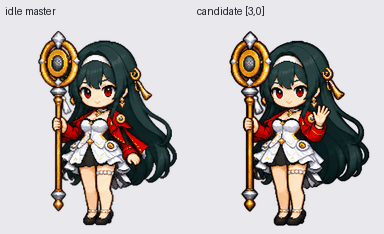

# 图集修复与逐帧复核

本轮完成于 2026-10-25。所有行列坐标从 0 开始。

本次修复覆盖整张图集的提取、定位和打包。挥手、跳跃、失败、等待、工作、检查及 16 向注视使用新的完整人物动作组；待机保留同一完整母帧与闭眼帧，跑步保留原动作源并重新完整提取。

## 发现和修复

原打包器按规则网格切原图，但生成图中的人物不总落在格线内。待机母版的完整高度为 469 个源像素，旧切片切掉约 9 个像素的鞋底，再缩到目标高度，因此后续与它对比的身体比例基准本身就不准确。向右跑和挥手等组也有跨格问题。

本轮先按完整连通人物提取，再由 work-pets 的提取、检查和组装脚本处理。普通动作组使用组内统一缩放，整组做一次平移；跳跃保留腾空与落地差。方向行先检查四个主方向，再先后生成两组，第二组沿用第一组注册比例。所有动作都保留完整人物，没有单独换头、复制待机腿部或非等比拉伸。

`matchWaveLegsToIdleMaster()` 已移除。正式构建现在只读取 `assets/atlas-source/coherent/rows/` 的固定格条带；不再重新缩放、裁边或计算人物中心。清单记录每行文件哈希和完整 RGBA 哈希，修改未审阅的素材会阻止打包；编码失败保留原文件。

工作行现在是站立处理任务与小幅手势，修正了此前复用跑步帧的语义。方向仍为屏幕光标注视：0° 上、90° 右、180° 下、270° 左；下看保持睁眼，头颈和肩部自然跟随。

## 固定坐标复查

以下窗口都从同一个待机母版坐标定义，然后原样裁取每一帧。没有逐格包围盒拟合或独立缩放。每行第一列均为母版，可直接比较裙摆、腿脚、法杖位置；跑步和跳跃允许肢体姿态改变，头部转向允许投影改变。

| 区域 | 固定矩形（右、下边界不包含） | 全帧对照 |
| --- | --- | --- |
| 头部 | `(61,12)-(142,92)` | [头部](atlas-qa/fixed-head.png) |
| 躯干 | `(63,86)-(140,148)` | [躯干](atlas-qa/fixed-torso.png) |
| 腿脚 | `(74,137)-(123,205)` | [腿脚](atlas-qa/fixed-legs.png) |
| 法杖 | `(33,4)-(74,195)` | [法杖](atlas-qa/fixed-staff.png) |

新挥手的头部、腰线、裙摆和腿脚与完整待机母版接近，未见旧版明显压扁、截鞋底和局部拼贴接缝。待机使用同一睁眼母帧，眨眼以外不切换不同身高的人物。这里的“接近”是逐帧目检结论，不是用肤色或服装像素面积推断人体比例。



[可逐帧暂停、叠加母版、鼠标绕圈和点击挥手的本地预览](atlas-qa/review.html) · [全部 88 格](atlas-all-frames.png) · [16 向标注图](atlas-look-directions.png)

## 校验与限制

最终文件为 1536×2288、RGBA lossless WebP、2,672,038 字节，73 个有效格、15 个透明空格。哈希为 `340bae6403c351960f3d0736994dfbc93b3b2521acfd31cfa2d816ab4e0ae1e4`。

- `audit-atlas.py` 与 skill 的 `validate_atlas.py` 通过；透明像素下的隐藏 RGB 为 0。
- skill 的最终 `validate_pet_quality.py` 通过，保留方向细节警告；[原始报告](atlas-qa/quality.json)。
- 跳跃相对待机基线的最大提升为 20 px，落地偏差 0 px。该数值采用 alpha>16 的可见边界；不是解剖学脚掌测量。
- 方向轮廓中心距母版最大 1.5 px，轮廓宽度比 1.07；含头发和法杖，不能当成头身比。
- `067.5→090`、`157.5→180`、`337.5→000` 有差分异常提示。最后一个接缝已重画以减少朝向跳变，但头发/脸部轮廓和纹理仍有小差异；不声称逐像素一致或完全无缝。部分中间角度在原生尺寸下区分较弱，[逐方向判断与证据](atlas-qa/direction-semantics.json)。
- 三名独立盲审工作者都因账号用量限制未完成；本轮视觉结论来自主代理目检，没有宣称独立审阅通过。上述动态与固定裁块预览保留供用户检查。
- 新素材本来具有透明背景。边缘清理脚本以 `strength=0` 运行并验证透明 RGB，避免对正确的半透明像素做不必要的变色。
- `npm run build`、86 项 Node 测试、10 项图集审计回归、3 项打包回归通过。打包回归包含像素不变、源图被改后拒绝覆盖、编码失败保留旧图。

## 复现与预览

```powershell
npm run build:atlas
python scripts/audit-atlas.py spritesheet.webp
python scripts/preview-atlas.py
python -B test/pack_atlas_test.py
```

打包和 GIF/裁块预览依赖 Python + Pillow；MP4 额外使用 opencv-python 和 numpy。`PYTHON` 环境变量可指定打包运行时。

[全动作 GIF](atlas-qa/all-states.gif) · [MP4](atlas-qa/all-states.mp4) · [待机→跳跃→待机](atlas-qa/idle-jump-idle.gif) · [待机→挥手→待机](atlas-qa/idle-wave-idle.gif) · [方向循环](atlas-qa/look-loop.gif)

原始生成图与已注册条带、提取边界、变换记录保存在 `assets/atlas-source/coherent/`。`generation.json` 区分原始完整提示词与归档摘要；旧源目录仅供历史参考，正式构建不再读取。
