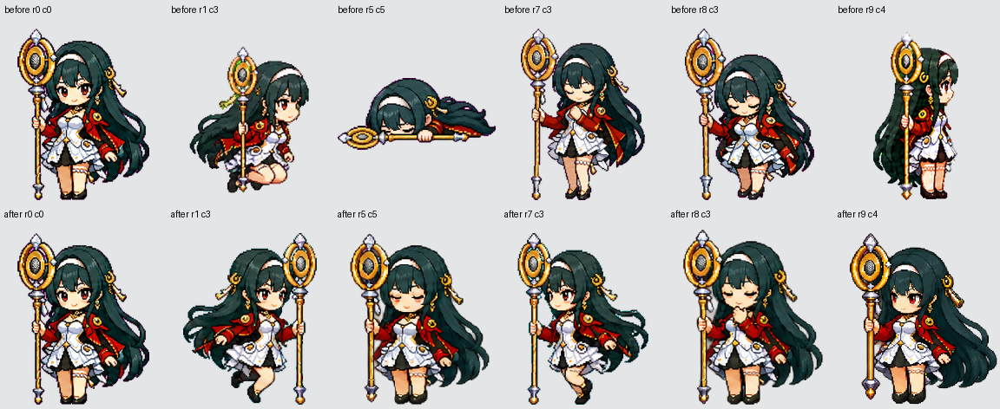

# 图集修复与复查记录

日期：2026-10-24。坐标均从 0 开始。

已替换仓库根目录 `spritesheet.webp`，并重建 `lib/client.js`。
当前图集为 **1536 × 2288、RGBA、静态 lossless WebP、3.12 MiB**。

上排为原图，下排为修复图；从左到右是母版、向右跑、失败、工作中、思考、注视。
[查看动画预览](atlas-preview.gif)：每个动作连播两轮，使用插件当前的行、帧数和间隔；
最后展示可选的 16 格注视姿势。GIF 只是带底色的审阅副本，正式图集保持透明。

## 实际修改

| 范围 | 修复方式 | 当前播放 |
| --- | --- | --- |
| 第 1 行 | 将第 2 行逐格镜像写入图片，移除原先忽然变矮的跪姿 | 原生第 1 行，8 帧，120 ms，不再叠加镜像 |
| 第 5 行 | 新绘整行为站立低落、叹气；消除站立、跪坐、躺平混用 | 完整 8 帧，140 ms，不再跳过第 5 列 |
| 第 7 行 | 从原图第 2 行抽取 6 个不同的跑步相位 `[0,1,3,4,5,7]` | 6 帧，120 ms，替代站立手势 |
| 第 8 行 | 新绘整行为抬头托腮、目光变化和眨眼 | 完整 6 帧，360 ms，不再重复取 `[2,3,2]` |
| 第 9–10 行 | 依据母版重绘站立注视姿势，使用同一组尺度和衣身锚点 | 16 格；光标跟随保持默认关闭 |
| 第 0、2、3、4、6 行 | 保留原画 | 与修复前相比，可见 RGBA 像素差异均为 0 |

新绘使用内置 **imagegen**。首次整张重绘候选未通过姿态与网格复查，未用于最终图集。
动作源图里生成的两组跑步也未采用：迈腿变化不足，容易变成只有头发在动。
最终保留连贯的原画跑步姿势，新绘只用于失败、思考与注视。
源图保存在 `assets/atlas-source/`，最终使用的提示词见 [atlas-generation-prompts.md](atlas-generation-prompts.md)。

## 复查中修正的问题

- 去掉新思考帧上方从前一行动作残留的孤立鞋尖像素；透明边缘去除极低 alpha 杂点。
- 以母版白色衣身的位置作为横向对齐参考，避免按头发和道具包围盒中心摆放导致身体漂移。
- 用每组源图共同的缩放比例归一画稿尺度，不逐格拉伸，也不裁掉头发来塞进格子。
- 修正播放端旧规避，防止修好右跑图片后再镜像一次、失败仍跳格、思考仍只取两张画。
- 审计脚本取消躺平豁免，补上真实透明度、格式、文件大小、空格位置和完整朝向检查。
  明确 `bottom=203` 是右开区间边界；包围盒包含道具，不能称作人体身高或脚底测量。
- 将测试入口改为显式 `test/*.test.js`，修正 Windows / Node 24 对目录参数的执行失败。

## 验证结果

| 检查 | 结果 |
| --- | --- |
| `python -B scripts/audit-atlas.py spritesheet.webp` | `OK`，退出码 0；结构检查通过 |
| `npm run test:atlas` | 10 个回归用例通过，包括空格错位、坏 idle 基线、躺平、缺 alpha、缺半套朝向 |
| `npm test` | 65 个插件用例通过；包括原生左右跑、完整失败循环、6 帧思考及首尾回环 |
| `npm run build` / `npm run verify` | 构建与包验证通过 |
| 再运行 `npm run build:atlas` | SHA-256 不变，可重复打包 |
| 逐行内容唯一性 | 新第 1、5、9、10 行各有 8 个不同帧；第 7、8 行各有 6 个不同帧 |
| 像素复核 | 第 1 行与第 2 行的逐格水平镜像完全对应；保留的 5 行可见像素未变 |
| 逐格画面复查 | 默认动作中未再发现跪姿混入跑步、失败突然躺平、思考切换姿势族、越格或悬空杂点 |

本次复查没有发现默认播放路径的阻断问题。该结论基于逐格图像、像素比较及客户端模拟播放测试，
没有声称已在真实 DSH 窗口中完成端到端操作。

可选注视动作仍有美术上的限制：16 格比例已接近母版，但部分相邻方向的头眼变化偏轻，
方向辨识度还可以加强；因此没有恢复默认开启。脚本 `OK` 不代表这些美术细节已经获自动认证。

最终图集 SHA-256：`d9b4748fc631d1d39d7885b5744e17f15a3eb6de0c6a4b1906420b72399d5db8`。
