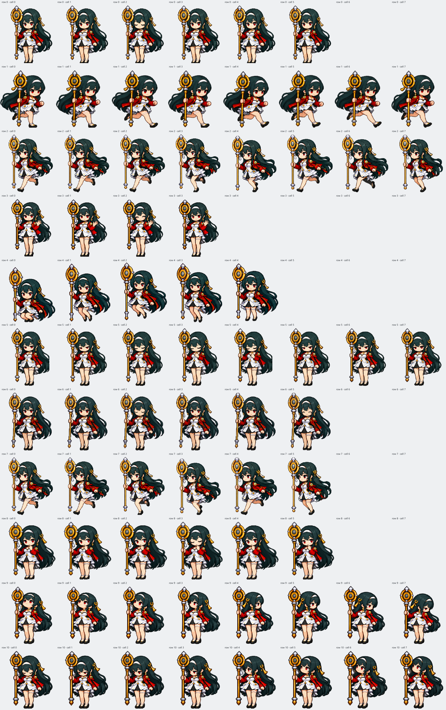

# 图集全量修复与复查

日期：2026-10-24。坐标从 0 开始。

正式图集为 **1536 × 2288 px、8 列 × 11 行、RGBA lossless WebP**。每格 192 × 208 px；当前 73 格有图，其余格透明。

上图按 2 倍放大，标出每行和每列，供逐格检查。另有[动作代表帧](atlas-review.png)、[挥手与待机比例对照](atlas-wave-review.png)和[完整 16 向顺序](atlas-look-directions.png)。正式图集保持透明背景，预览使用灰底。

## 本轮处理

- 向右跑与向左跑分别使用独立全身帧。法杖都留在画面左侧，不再镜像整个人物导致法杖换边；两行脚底和占用高度对齐。
- 待机循环使用同一个睁眼母帧和同比例闭眼帧，6 格中只保留一次眨眼；原图其余姿势的腿部可见长度短了 6–8 px，容易让站姿产生缩身感。现在待机行使用 6 格，未使用的第 7 格留空，脚底均在 `y=203`。
- 挥手行曾有轻微变扁：裙装比待机宽、可见腿段略短。现按单帧待机母版重绘四个完整角色帧；裙装宽度中位数约 `68.5/66 px`，可见腿高约 `64.5/65 px`（挥手/待机），脚底仍对齐。失败和思考同样使用完整角色帧，不从待机母版局部拼贴脸或手。
- 挥手四格保持右侧自由手抬起；失败八格全程站立；思考六格维持托腮并做细微目光和眨眼变化。
- 第 9–10 行改为完整 360° 屏幕方向注视：0° 向上、90° 向右、180° 向下、270° 向左，每格 22.5°。头颈、肩部和少量上身顺着视线自然跟随；下身、脚和法杖保持稳定。每格均为完整角色帧，没有单独替换头部，也不做全身旋转。
- 复看时发现方向两行原占用高度中位数为 `192.5/197.5 px`，且第 10 行源图横向比例偏宽。重画第 10 行后，两行分别按组内中位高度等比缩放到 `198/198 px`；打包器只指定目标高度，由 Sharp 按原始宽高比计算宽度。每行内部仍用单一缩放值，没有横向压扁或逐格拉伸，脚底均在 `y=203`。
- 其他站立行以完整角色组等比缩放，并以身体锚点横向定位。跳跃保留腾空高度变化；各行末尾空格留透明。
- 逐格查看了 88 个位置，包括动作循环、方向顺序和空格。当前动作各行没有裁切或持杖换边；方向环在 `337.5° → 000°` 处回接到向上姿势。

## 自动检查

| 检查 | 结果 |
| --- | --- |
| `npm run build:atlas` | 完成；生成 1536 × 2288 RGBA lossless WebP，约 2.7 MiB |
| `python scripts/audit-atlas.py spritesheet.webp` | `OK`，退出码 0；尺寸、透明度、帧数、边缘、站立高度和基线通过 |
| 站立脚底 | 基线 `y=203`；跳跃行允许落地/腾空变化 |
| 方向覆盖与大小 | 16/16 格；两行中位占用高度 `198/198 px`；面部区域像素变化 73%，包围宽度变化 7%（仅作诊断） |
| 代码构建 | `npm run build` 完成；浏览器客户端生成全 360° 光标映射 |

审计脚本检查方向两行高度中位数相差不超过 2%，但包围盒仍包含头发和法杖，不等于人体身高或脚掌测量；方向像素数也不能单独证明主方向正确。插件测试套件本轮未运行。

## 重打包

运行 `npm run build:atlas` 会从 `assets/atlas-source/normalized/` 与 `assets/atlas-source/look/` 重建完整图集，再运行 `python scripts/audit-atlas.py spritesheet.webp` 并检查上方预览。每次替换源图后，都要核对其实际网格布局与打包器参数。
